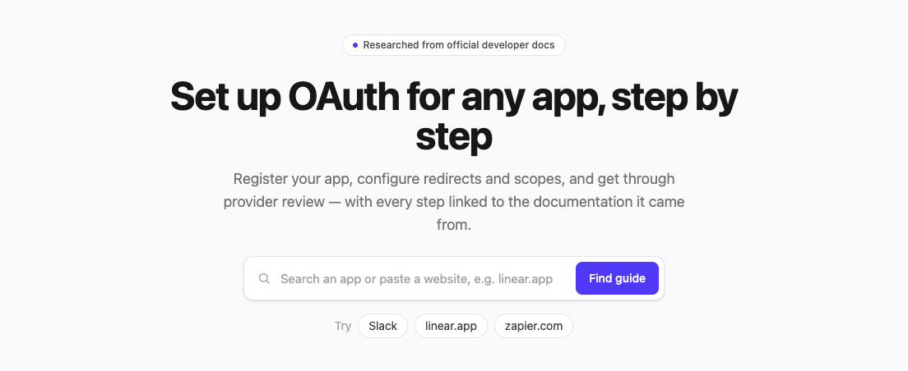
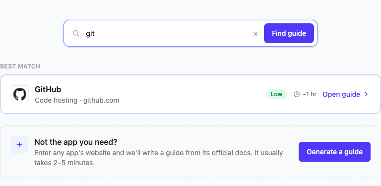
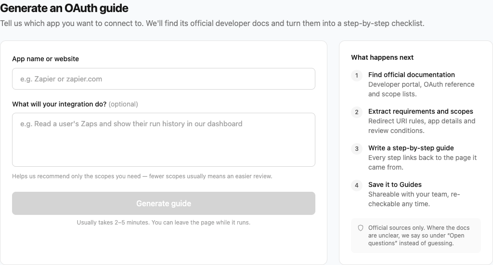
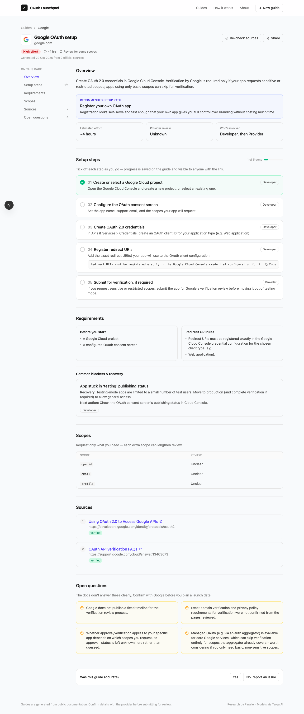
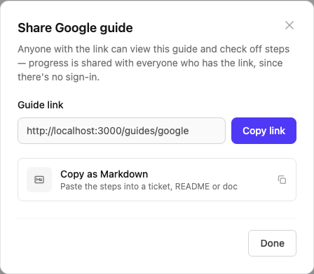

<div align="center">



### Set up OAuth for any app, step by step.

Look up an app (or paste any website) and get a sourced, shareable,
step-by-step guide — what to do, who does it, how long it takes, and what's
genuinely unclear versus what the docs confirm.

[](.github/workflows/ci.yml)


**[Live demo →](#)** _(add your deployed URL once published — see [DEPLOY.md](DEPLOY.md))_

</div>

---

## The problem

Building an app or agent that connects to GitHub, Slack, Google, or
something more obscure almost always starts the same way: you need to
register an OAuth app with that provider before anyone can use it. Which
means digging through scattered developer docs to work out redirect URI
rules, which scopes you actually need, and whether the provider is going
to review and approve your app before real users can connect through it.

It's rarely obvious upfront whether that's a 10-minute form or a two-week
wait on someone else's approval queue — and every provider explains it
differently.

**OAuth Launchpad turns "go read the docs" into a checklist you can follow
and hand to a teammate.**

## See it in action

<table>
<tr>
<td width="50%" valign="top">

**Search, live**
Type an app name or paste a website — matches your existing guides
instantly, and offers to research anything it doesn't know yet.



</td>
<td width="50%" valign="top">

**Generate a guide**
Tell it what your integration will do (optional — narrows the scopes it
recommends) and it researches live: search → fetch docs → extract →
write, sourced the whole way.



</td>
</tr>
</table>

**A full guide**, built from real documentation — every claim sourced,
every gap flagged instead of guessed:



**Share it** with a teammate — the link stays stable, and you can drop the
whole checklist into a ticket as Markdown:



## How it works

```
Browser (Next.js)  ──▶  FastAPI backend  ──▶  Tavily (web search + fetch)
                              │                        │
                              ▼                        ▼
                        SQLite (guides)  ◀──  TarqaAI (LLM extraction)
```

The research pipeline (`backend/research.py`) does the actual work. For a
given app name or URL, it runs through these stages in order, streaming
each one's progress to the browser as it completes:

| # | Stage | What it does |
|---|-------|---------------|
| 1 | `identify_provider` | Resolves a name or URL to the provider's real domain — searches when given just a name, trusts a pasted URL after a safety check. |
| 2 | `search_documentation` | Searches specifically for that provider's OAuth / developer docs, with a domain-ownership heuristic so a well-SEO'd third-party tutorial doesn't get mistaken for the provider's own site. |
| 3 | `fetch_documentation` | Fetches full page content for the most relevant results. |
| 4 | `extract_requirements` | Sends those excerpts — not training knowledge — to an LLM via TarqaAI, instructed to answer only from the provided text and leave fields empty rather than guess. |
| 5 | `validate_findings` | Attaches every fetched page as a source, marking it "verified" only if served from the provider's own domain, and flags anything important that couldn't be confirmed instead of assuming one. |
| 6 | `generate_guide` | Assembles and validates the final guide against a strict schema, coercing any stray LLM vocabulary (an out-of-range enum value, say) to a safe default instead of failing the whole run. |

No simulated loading animation, no hardcoded guide data — what you watch
happen on screen is what's actually happening on the backend.

**What it does and doesn't do**, because this matters for trust: it reads
real, current, official documentation and turns it into structured
guidance. It does **not** click through a provider's actual developer
console, register a real OAuth app, or submit anything for review —
those steps need a human with real credentials, and every setup step is
tagged `Developer`, `Provider`, or `Agent` so it's always clear who does
what. The in-app **About** page has the full explainer.

### The data model

Every guide separates *facts the docs state* from *judgment calls layered
on top of them*:

- `setup_steps`, `required_scopes`, `redirect_uri_requirements`,
  `prerequisites`, `blockers` / `recovery_actions` — extracted from the
  docs, sourced.
- **`recommended_setup_path`** (custom vs. managed) — the question a
  developer actually has: register your own OAuth app, or is a
  pre-approved managed app from an auth aggregator enough? Weighs
  registration friction against the branding/control you give up, and
  defaults to `unknown` rather than guessing when the evidence doesn't
  clearly support either answer.
- `estimated_hands_on_setup_hours` vs. `estimated_external_wait_days` —
  kept separate on purpose: one is your engineering time, the other is
  time spent waiting on the provider.
- `unknowns` — anything the docs didn't cover clearly, shown as "Open
  questions" instead of being invented.

## What's verified vs. what's uncertain

- The seeded guides (`backend/seed_data.py`) were hand-checked against the
  official docs linked in their `sources`; anything the docs didn't state
  precisely (Google's verification review timeline, for instance) is
  listed under `unknowns`, not guessed.
- Every live-generated guide carries its own `sources` list with a
  `verification_status` per page and its own `unknowns`, generated fresh
  from whatever the pipeline actually found for that run.
- **Re-check sources** re-runs the full pipeline against a guide's current
  docs and overwrites it in place, so a guide doesn't go stale while its
  share link stays the same.
- What's *not* independently verified: nobody has completed a real OAuth
  app registration end-to-end with a provider through this tool —
  guidance is only as reliable as the documentation it was extracted
  from, which is exactly why every claim is sourced and genuinely unclear
  points are surfaced instead of smoothed over.

## Scope

- **A handful of pre-seeded guides with different setup profiles** (no
  approval needed, optional review, conditional verification), plus a
  **live generation flow that works for any app** — the seeded guides
  demonstrate the format, the live flow is what actually scales.
- **SQLite**, one file, one process — fine for demonstrating the product,
  not for concurrent-writer production scale. `database.py` is a single
  small module specifically so swapping it for Postgres later is
  contained.
- **No accounts / auth** — guides are addressed by a stable ID and anyone
  with the link can view and check off steps. Keeps sharing frictionless,
  but means checklist progress is shared by everyone who has the link,
  not private per visitor.

## Known limitations

- **Shared, not per-user, checklist state.** No sign-in means a step you
  tick off is visible to everyone who opens that guide's link.
- **No per-scope review detail.** The Scopes table shows each scope
  alongside the guide's overall review status — the extraction pipeline
  doesn't produce a verified per-scope "grants" description, and showing
  one would mean inventing it.
- **Steps aren't individually footnoted to a specific source** — sources
  are attached at the guide level, not mapped one-to-one with setup steps.
- **Feedback widget** ("Was this guide accurate?") is a local
  acknowledgment only; not persisted anywhere yet.
- **Single SQLite file.** The natural next step under real concurrent
  traffic is Postgres (noted in `DEPLOY.md`).
- **No live registration testing.** The agent reads and extracts from
  documentation; it doesn't drive a provider's actual developer console.

## Running it locally

Requires API keys for [Tavily](https://tavily.com) (web search/fetch) and
a TarqaAI-compatible LLM endpoint (OpenAI-compatible).

```bash
# Backend
cd backend
python -m venv venv && source venv/bin/activate
pip install -r requirements.txt
cp .env.example .env   # fill in TAVILY_API_KEY, TARQA_API_KEY, TARQA_MODEL
uvicorn main:app --reload --port 8000

# Frontend (separate terminal)
cd frontend
npm install
echo "NEXT_PUBLIC_API_URL=http://localhost:8000" > .env.local
npm run dev
```

Open http://localhost:3000 — the backend seeds its example guides on
first startup.

### Tests

```bash
cd backend && pytest tests/ -q        # 69 tests, no API keys required
cd frontend && npx tsc --noEmit && npm run lint && npm run build
```

Both run automatically in CI on every push/PR (`.github/workflows/ci.yml`).

## Deploying

See **[DEPLOY.md](DEPLOY.md)** — Fly.io for the backend (persistent
volume, so the database and every share link survive redeploys) and
Vercel for the frontend, both wired to GitHub for CI/CD from this same
repo.

## Key decisions, summarized

| Decision | Why |
|---|---|
| Stream research progress over NDJSON instead of polling | Real progress, no fake loading bar; the UI shows exactly what stage is running. |
| Separate `sources` + `verification_status` per guide | "Sourced" is a verifiable, per-guide fact, not a blanket claim. |
| `unknowns` as a first-class field | The model leaves gaps empty rather than guessing; gaps surface as "Open questions" instead of silently vanishing. |
| `recommended_setup_path` (managed vs. custom) | The central question a developer actually has, answered as a judgment call that's explicit about its own uncertainty. |
| Guide IDs are stable, re-checkable in place | A share link keeps working and stays current without ever changing URL. |
| Coerce invalid LLM enum values instead of failing the run | A vocabulary slip (an out-of-range `setup_complexity`, say) shouldn't waste a multi-minute research run. |
